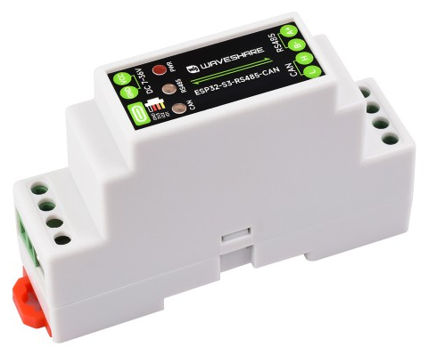
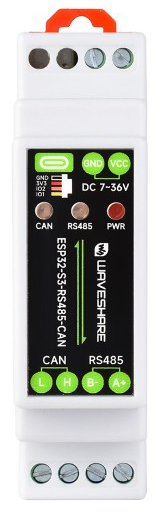
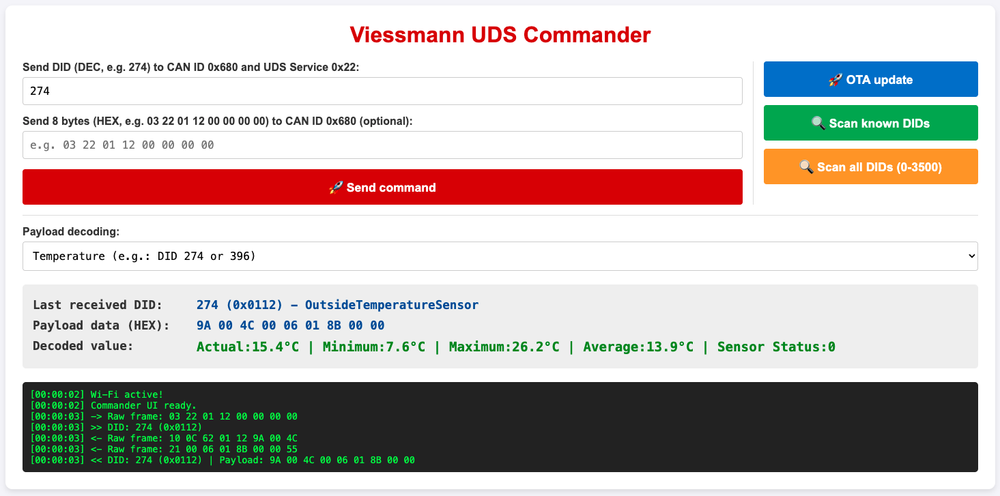
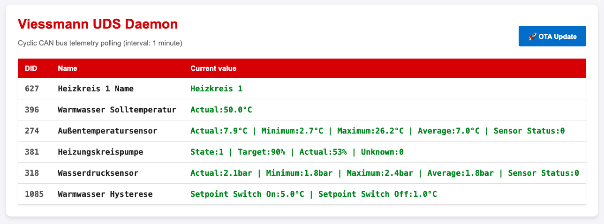
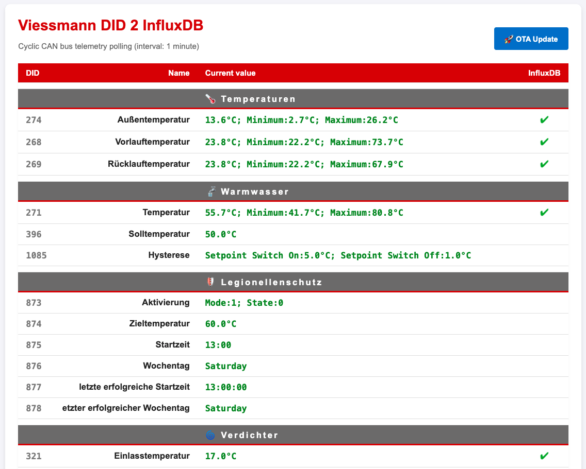

# CanBusD  
## Background & Reason for Development  
I was looking for cost-effective hardware that would allow me to read as much data as possible from my Viessmann heat pump.
- The only official option: WAGO PLC with CAN bus (approx. €1400)  
- [open3e](https://github.com/open3e/open3e) It runs on a Raspberry Pi or in a Docker container  
that’s too much and I can’t use it to write data to my InfluxDB.  
- [Der HCV Adapter](embdes.com) I actually would have bought that one,  
but I still wouldn't be able to use it to write the data into my InfluxDB.  

Then I remembered that Dave Jones from EEVblog. In a video titled  
["EEVblog 1765 - This $19 ESP32 Makes Home Automation EASY!"](https://www.youtube.com/watch?v=kHu2xe9iCIc&t=1148s)  
showcased an ESP32 that he used for his ventilation system.  
And the module has a CAN bus!

## Hardware  
### [ESP32-S3-RS485-CAN](https://www.waveshare.com/esp32-s3-rs485-can.htm?srsltid=AU7gw4UBb7m5bKDP9epj_9h0QPumj4ANPL_AVdqtJ7dzOMvFQwdwILDE)  
Industrial ESP32-S3 Control Board With RS485 And CAN Communication Interfaces, Supports Wi-Fi / Bluetooth, Built-in Multiple Protection Circuits  

  
  
## Software
The collection of DIDs in the file `known_dids.h` is a blend of data from a list of DIDs from [`hcv`](https://github.com/chrkir/hcv/) and the properties of the DIDs from [`open3e`](https://github.com/open3e/open3e).  
  
### Viessmann UDS Commander
The Viessmann UDS Commander is designed for verifying communication with devices such as heat pumps. It allows for testing individual DIDs and decoding the bytes returned in response to requests. It can either query a list of known DIDs or perform a sweep, starting from 0 up to 3500, to check for responses from the device. The resulting list can then be downloaded for further use.  
  
  
### Viessmann UDS Deamon
The Viessmann UDS Daemon is intended for testing the periodic retrieval of a fixed list of DIDs, as well as the display of the returned values.  
  
  
### Viessmann DID 2 InfluxDB
Viessmann DID 2 InfluxDB is a ready-to-use firmware that retrieves a list of DIDs, presents all the results in a clear format, and sends the DIDs I wish to log to my InfluxDB.  
  